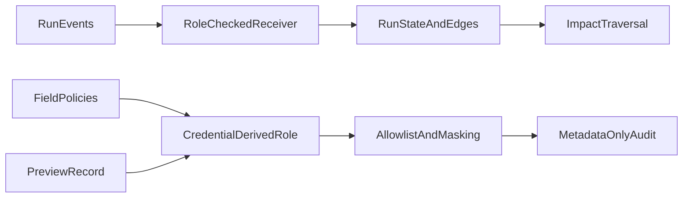

# Architecture and review guide

## Execution boundaries

A persistent OpenLineage-style run-event receiver records job transitions, dataset dependencies, and column lineage facets. It provides bounded transitive impact analysis, role-controlled field policies, allowlist-based record projection, keyed pseudonymization, and metadata-only preview audits. Server-validated credentials determine roles; request payloads cannot claim steward privileges.

## Decisions to review

The receiver implements a documented subset of OpenLineage run and column facets, not full schema conformance or an Apache Atlas replacement. Historical edges remain in the catalog, so impact is a conservative union across completed runs. HMAC is pseudonymization, not anonymization. Last-four masking can leak information and must be explicitly selected by policy. Preview records are not persisted, but lineage payloads and policies are; send metadata only. A real deployment needs federated identity, TLS, secret rotation, audit retention, and a multi-process database.

## Failure exercise

1. Run the supplied synthetic example and record its state or output.
2. Run the same input again. Inspect the replay policy: event/batch idempotency for transactional systems, stable latest-state results for CDC, pinned versions for contracts, and explicit output prefixes for Beam.
3. Introduce a malformed input and run the tests that exercise rejection. Check whether the contract requires quarantine or whole-batch failure before re-running.
4. Stop the persistence service during a write when using a deployed topology. Confirm that the consumer/scheduler does not advance its source checkpoint before the sink commits.
5. Recover from the retained input. Inspect receipts, rejects, run metadata, or comparison reports instead of assuming a successful process exit implies end-to-end correctness.

Steps requiring Kafka, PostgreSQL, Airflow, Spark, or containers are deployment exercises, not claims that those environments were tested here. See `VALIDATION.md` for executed evidence.

## Portfolio discussion

Be prepared to explain the input grain, key/version contract, transaction boundary, retained state, failure recovery, and the changes required for multiple workers or a cloud deployment. The implementation deliberately exposes these decisions rather than claiming scale from a small synthetic example.
